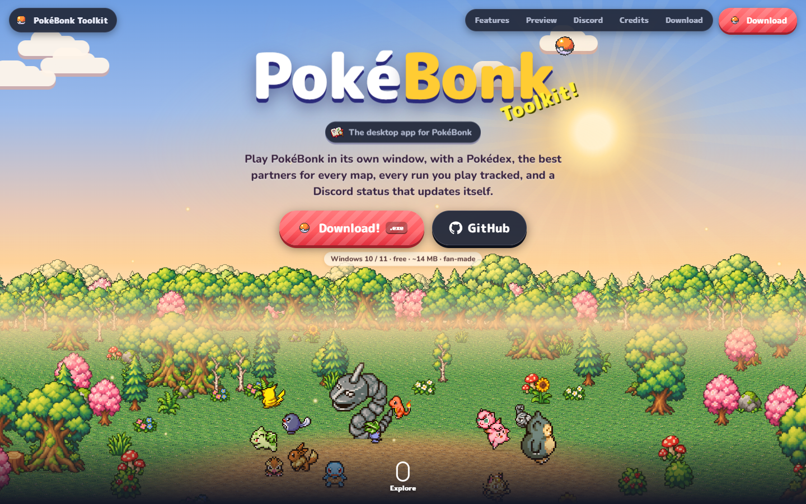

# PokéBonk Toolkit

A desktop and Android client for [PokéBonk](https://pokebonk.com) with a built-in toolkit:
Pokédex, type chart, map guides, run history with progress charts, and an automatic Discord status.

**Download:** [pokebonk.deepexe.fr](https://pokebonk.deepexe.fr)



## Features

- **Toolkit menu** (F2 or the button in the corner), styled like the game: Pokédex, types, maps with the best partners for each one.
- **Run tracking**: every run is saved (map, Pokémon, level, K.O., time, result). The Progress page shows your stats and how they change over time.
- **Discord status**: shows the map and your Pokémon in pixel art, live level and K.O. count, and a VICTORY picture after a win.
- **Real fullscreen** with F11 or the game's button, and a volume control.

## Repository

| Folder | What it is |
| --- | --- |
| `PokeBonk/` | Windows app: `pokebonk.py` (pywebview window, Discord status) and `hub.js` (toolkit injected into the game) |
| `PokeBonk/tools/` | Scripts that generate the Discord pictures and the landing page sprites |
| `android/` | Android app: a WebView that loads the game with the same `hub.js` |
| `site/` | Landing page served at pokebonk.deepexe.fr |

The Discord pictures are hosted in [Deepexee/PokebonkImage](https://github.com/Deepexee/PokebonkImage).

## Build

### Windows

Needs Python 3 (with the `py` launcher).

```bat
cd PokeBonk
build.bat
```

The app is written to `PokeBonk/dist/PokeBonkApp.exe`.

### Android

Needs JDK 21 and the Android SDK (`platforms;android-35`, `build-tools;35.0.0`). No Gradle.

```powershell
cd android
.\build_apk.ps1 -VersionCode 2 -VersionName 1.1
```

The script copies `hub.js`, `typedex.json` and `maps.json` from `PokeBonk/`, then writes `android/PokeBonk.apk`.
On the first build it creates a signing key (`pokebonk.keystore` and `keystore.properties`). Keep them safe and out of git: updates must be signed with the same key.

## Credits

Made by **Deepexe** and **Kanami**. Fan-made, not affiliated with PokéBonk, Nintendo or The Pokémon Company.
Sprites from the game and from [PMD SpriteCollab](https://github.com/PMDCollab/SpriteCollab).
